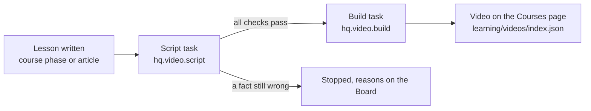

# Narrated lesson videos

Mission HQ makes a long, narrated teaching video from any finished lesson: a
course phase, or a Learn article. The video teaches every concept the lesson
teaches, in the lesson's depth, told as one story: a cold open with a
question, one running case, a bridge from each concept to the next, and a
payoff that answers the question. A video is made only when he asks for it
("Generate video" on the page, or in chat); from there it goes from script to
render on its own, with no approval step.

YouTube episodes are not made here. They are cut by hand in a Claude session
with the `video-remotion` skill from the `dhakarRaghu/claude-plugin` repo.
The skill for this pipeline is `missionhq-video` (`.claude/skills/missionhq-video`).

## The flow

## Stage 1: the script (`backend/src/hq/video/script.py`)

Every model call is a durable step, and every artifact is saved in the job
folder as soon as it exists, so a restart resumes.

| Step | Model | What happens | What checks it |
|---|---|---|---|
| gather | none | the lesson, and for a course phase hunter's study note; the think-it-through questions earlier videos of the course already asked | |
| plan | `deep` (kimi_deep, effort high) | the running case, the question, every concept with each step planned, the payoff, and every mismatch in the lesson's own numbers | `checks.plan_problems`: concept count, headings, every `evidence_quote` found word for word in the material. Sent back up to 4 times |
| beats | `deep` | one call per beat, given the end of the beat before | `checks.line_problems` and `checks.concept_problems` on every line: banned words, part names, questions out of place, sentence length, the fixed think-aloud phrases, step numbering, `say` for every digit and symbol. A beat goes back twice at most |
| whole | none | the order of beats, the length, the share of very short sentences | `checks.narration_problems` |
| editor | `teacher` (kimi_k3, a different model) | scores every concept and the payoff on seven criteria, with quotes | a beat with a score under 4 or a mean under 3.5 is rewritten with its instructions, two rounds |
| facts | `teacher` | maps every factual line to the material and redoes the arithmetic | a contradicted or unsupported line sends its beat back with the correction, two rounds |
| scenes | `deep` | one call per beat returns its part of the video spec, as data | `video/scripts/check-spec.mjs`: the contract in `video/SPEC.md`, every text limit, every `at` key |

The prompts are in `agents/tutor/video/`: `rules.md` (the narration rules,
from twelve finished episodes and their reviews), `plan.md`, `beat.md`,
`editor.md`, `factcheck.md` and `scenes.md`. The writer stages also get the
charter and `agents/tutor/writer/teacher.md`. The reviewers get only what
they judge against.

The effort is "high", the highest value measured to change anything on this
gateway (see the notes in `backend/models.yaml`). Depth comes from the two
independent reviews and their repair rounds, not from the effort string.

## When a script stops

A script that still states a contradicted or unsupported fact after its
repair rounds, or still fails a code check, does not go on to the voice: a
wrong line would be spoken in the video. The task ends "failed" with the
reasons, which the Board and Courses → Videos show. "Make it again" there
starts a new script for the same lesson.

## Stage 2: the build (`backend/src/hq/video/build.py`)

The long steps run as detached processes in `video/`, each writing a log and
a done marker in the job folder. The backend polls them, one durable step per
poll, and records a progress event each time, so the hang watchdog sees a
render as alive and a restart resumes polling instead of rendering again.

1. `narrate`: Kokoro (`af_heart`, speed 0.94) voices every line and writes
   the timing file.
2. `stills`: one still per scene step, and a tiled `sheet.jpg`.
3. `frames`: the teacher model (kimi_k3) looks at every still next to the
   lines the voice speaks during it: cut-off or overlapping text, an empty
   box, a number that differs from the voice, something the voice describes
   that is missing. A failing beat's scenes are written again and its stills
   rendered again, twice at most; a beat that still fails stops the video.
   Kimi reads stills correctly (tested on 2026-10-06: every line of text and
   its colour read back, no invented overlaps).
4. `render`: the video, one at a time on the `videos` lane, because a render
   keeps the CPU about 97% busy.
5. `verify`: code checks the file: audio sync (every spoken line's measured
   start against the timing file), frame count, near-empty or repeated
   frames, keyframes, loudness, black frames and stream format.
6. `captions`: captions and chapters. Then the video is copied into the media
   folder and registered in `learning/videos/index.json`, and the Courses page shows it.

## Where the files are

Code, prompts and the video list are in git: `agents/tutor/video/`,
`backend/src/hq/video/`, `video/` (without `node_modules` and `out/`) and
`learning/videos/index.json`. Job folders (`data/video-work/<id>/`) and the
finished videos (`data/media/<course>/`) are not: one video is 160 MB to
1 GB, and GitHub refuses files over 100 MB. How the console plays them,
the endpoints and the manifest entry are in [videos.md](videos.md).

Environment, all optional: `VIDEO_PROJECT_DIR`, `VIDEO_WORK_DIR`, `MEDIA_DIR`,
`VIDEO_NODE_BIN` (an arm64 Node; an x86 Node breaks Remotion; without it the
`node` on PATH), `KOKORO_DIR`.

Running one lesson by hand, without a second backend:
`uv run python scripts/video_run.py script|repair|build …` in `backend/`.

## How a video starts

Only when he asks. Nothing on the learning chain or the schedule starts a
video: a written phase or article ends its chain, and the nightly backfill is
gone. The two starts are "Generate video" on a phase or an article
(`POST /videos/make`) and sage's `start_video` in chat; both call
`hq.video.jobs.start`, which:

- leaves a video alone while a task is making it (any task whose payload
  names the video);
- builds a stopped job again from its script when that script passed every
  check and review and the lesson has not changed since (`can_rebuild`), so a
  failed render costs a render, not hours of writing; `fresh` writes anew;
- otherwise writes the script from the lesson, then builds it.

A job file is written by its task, so a task that dies without writing it
(a missing program, a deploy, a timeout) would leave it "writing" forever.
`jobs.settle` compares the file with the task board on every read and marks
such a job failed, with the task's own error, so the page offers it again.
