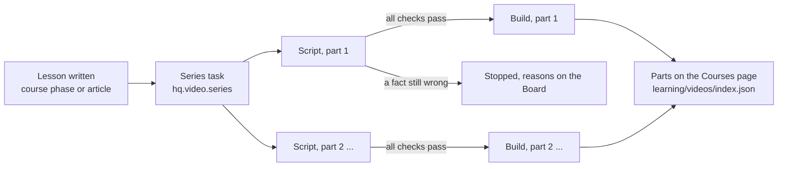

# Narrated lesson videos

Mission HQ makes narrated teaching videos from any finished lesson: a course
phase, or a Learn article. Together they teach every concept the lesson
teaches, in the lesson's depth, as a series of parts of about ten minutes.
Each part is one story: a cold open with a question, one running case, each
concept asked before it is answered, a bridge from each concept to the next,
a payoff that answers the question, and, in every part but the last, the
question the next part answers. A video is made only when he asks for it
("Generate video" on the page, or in chat); from there it goes from plan to
render on its own, with no approval step.

Why parts: one video per lesson ran 20 to 49 minutes and lost the viewer
after five to ten (2026-10-14). The lesson is not cut; it is told in
pieces, and part 1 can be watched while the later parts are still built.

YouTube episodes are not made here. They are cut by hand in a Claude session
with the `video-remotion` skill from the `dhakarRaghu/claude-plugin` repo.
The skill for this pipeline is `missionhq-video` (`.claude/skills/missionhq-video`).

## The flow

| Lane | Runs | At once |
|---|---|---|
| `video_scripts` | the series task and every part's script: model calls only | 2 |
| `videos` | every part's build: the voice, the stills and the render keep the CPU busy | 1 |

A script never waits behind a render (the phase-05a script waited seven
hours behind one on 2026-10-11), and the gateway's slot limit
(`llm._slot_limit`) still caps the model requests in flight.

## Stage 0: the series (`backend/src/hq/video/series.py`)

One `deep` call (`agents/tutor/video/series.md`) plans the series: every
concept of the lesson, the running case, and the parts, 2 to 4 concepts each
(1 to 3 concepts is one part; 4 to 8 two or three; 9 to 12 three or four),
each with its title, its question, how it answers it, and `leads_to`, the
question it hands over to the next part. `checks.series_problems` checks it
and sends it back up to 4 times. The plan is saved as
`data/video-work/<lesson>/series.json`, and one script task starts per part,
with the video id `<lesson>-p<n>`.

## Stage 1: the script (`backend/src/hq/video/script.py`)

Every model call is a durable step, and every artifact is saved in the job
folder as soon as it exists, so a restart resumes.

| Step | Model | What happens | What checks it |
|---|---|---|---|
| gather | none | the lesson, and for a course phase hunter's study note; the series plan and this part's place in it; the questions earlier videos of the course already asked | |
| plan | `deep` (kimi_deep, effort high) | this part's concepts, each step of the story order planned (situation, question, first answer and what it misses, picture, mechanism, number, takeaway, bridge), the payoff, and every mismatch in the lesson's own numbers | `checks.plan_problems`: the part's concept count, headings, every `evidence_quote` found word for word in the material. Sent back up to 4 times |
| beats | `deep` | one call per beat, given the end of the beat before; the cold open of a later part picks up the last part's hand-over, and the end beat hands over to the next part | `checks.line_problems` and `checks.concept_problems` on every line: banned words, part names, questions out of place, sentence length, the story order (the claim is the takeaway at the end), no fixed phrase ("Here is the question", "Remember:", "Step 1."), `say` for every digit and symbol. A beat goes back twice at most |
| whole | none | the order of beats, the length, the share of very short sentences | `checks.narration_problems` |
| editor | `teacher` (kimi_k3, a different model) | scores every concept and the payoff on seven criteria, with quotes, including `stakes` (he knows why the beat matters before it explains), a second running case, a line said twice, and two values for one quantity | a beat with a score under 4 or a mean under 3.5 is rewritten with its instructions, two rounds |
| facts | `teacher` | maps every factual line to the material, redoes the arithmetic, and checks each beat against the whole narration, so a value that disagrees with another line is caught | a contradicted or unsupported line sends its beat back with the correction, two rounds |
| scenes | `deep` | one call per beat returns its part of the video spec, as data, version 2 (the story order) | `video/scripts/check-spec.mjs`: the contract in `video/SPEC.md`, every text limit, every `at` key |

The prompts are in `agents/tutor/video/`: `rules.md` (the narration rules,
from the finished videos and what was wrong with them), `series.md`,
`plan.md`, `beat.md`, `editor.md`, `factcheck.md` and `scenes.md`. The writer stages also get the
charter and `agents/tutor/writer/teacher.md`. The reviewers get only what
they judge against.

The effort is "high", the highest value measured to change anything on this
gateway (see the notes in `backend/models.yaml`). Depth comes from the two
independent reviews and their repair rounds, not from the effort string.

## When a script stops

A script that still states a contradicted or unsupported fact after its
repair rounds, or still fails a code check, does not go on to the voice: a
wrong line would be spoken in the video. The task ends "failed" with the
reasons, which the Board and Courses → Videos show. The other parts go on.
"Generate again" goes on with the series part by part: a built part is
kept, a part whose script passed and whose build stopped is built again from
that script, and any other part writes its script again. Once every part is
built, or the lesson has changed, a press plans the series anew.

## Stage 2: the build (`backend/src/hq/video/build.py`)

The long steps run as detached processes in `video/`, each writing a log and
a done marker in the job folder. The backend polls them, one durable step per
poll, and records a progress event each time, so the hang watchdog sees a
render as alive and a restart resumes polling instead of rendering again.

1. `narrate`: Kokoro (`af_heart`, speed 0.94) voices every line and writes
   the timing file.
2. `stills`: one still per scene step, and a tiled `sheet.jpg`.
3. `frames`: the teacher model (kimi_k3) looks at every still next to the
   lines the voice speaks during it: cut-off or overlapping text, an empty
   box, a number that differs from the voice, something the voice describes
   that is missing. A failing beat's scenes are written again and its stills
   rendered again, twice at most; a beat that still fails stops the video.
   Kimi reads stills correctly (tested on 2026-10-06: every line of text and
   its colour read back, no invented overlaps).
4. `render`: the video, one at a time on the `videos` lane, because a render
   keeps the CPU about 97% busy.
5. `verify`: code checks the file: audio sync (every spoken line's measured
   start against the timing file), frame count, near-empty or repeated
   frames, keyframes, loudness, black frames and stream format.
6. `captions`: captions and chapters. Then the video is copied into the media
   folder and registered in `learning/videos/index.json`, and the Courses page shows it.

## When the Mac sleeps

The backend holds the machine awake with `caffeinate -s`, which works only
on AC power. On battery the laptop slept through three video tasks
(2026-10-11 to 10-13): a 36-minute video's build took 10.5 hours, about 3.4
of them awake. Now:

- a video task holds `caffeinate -i` while it runs (`pipeline.awake`), and
  every detached voice, stills and render process holds its own, so the Mac
  stays awake on battery too. Closing the lid still sleeps it.
- a task the watchdog queued again after a sleep runs as a new workflow, with
  no record of the old steps, so each stage resumes from the job folder. The
  script records its finished stages in `job.json` (`stages`) and keeps the
  beats it already wrote. Each long build step records its inputs and its
  process (`<step>.run.json`): a step that finished on the same inputs is
  skipped, one still running is polled and never started a second time, and a
  frame review that passed on the same spec (`frames.ok`) is not repeated.

## Where the files are

Code, prompts and the video list are in git: `agents/tutor/video/`,
`backend/src/hq/video/`, `video/` (without `node_modules` and `out/`) and
`learning/videos/index.json`. Job folders (`data/video-work/<id>/`) and the
finished videos (`data/media/<course>/`) are not: one video is 160 MB to
1 GB, and GitHub refuses files over 100 MB. How the console plays them,
the endpoints and the manifest entry are in [videos.md](videos.md).

Environment, all optional: `VIDEO_PROJECT_DIR`, `VIDEO_WORK_DIR`, `MEDIA_DIR`,
`VIDEO_NODE_BIN` (an arm64 Node; an x86 Node breaks Remotion; without it the
`node` on PATH), `KOKORO_DIR`.

Running one lesson by hand, without a second backend:
`uv run python scripts/video_run.py script|repair|build …` in `backend/`.

## How a video starts

Only when he asks. Nothing on the learning chain or the schedule starts a
video: a written phase or article ends its chain, and the nightly backfill is
gone. The two starts are "Generate video" on a phase or an article
(`POST /videos/make`) and sage's `start_video` in chat; both call
`hq.video.jobs.start`, which:

- leaves a lesson alone while a task is making its video (the series task,
  or any task whose payload names one of its parts);
- goes on with a planned series part by part when the lesson has not
  changed since it was planned (see "When a script stops"); `fresh` plans
  anew;
- builds a video made before series again from its script when that script
  passed every check and its build stopped (`can_rebuild`);
- otherwise plans the series, which starts its parts.

When a part is published, the lesson's one long video from before series
leaves the page; when a series is planned again with fewer parts, its old
later parts leave too.

A job file is written by its task, so a task that dies without writing it
(a missing program, a deploy, a timeout) would leave it "writing" forever.
`jobs.settle` compares the file with the task board on every read and marks
such a job failed, with the task's own error, so the page offers it again.
