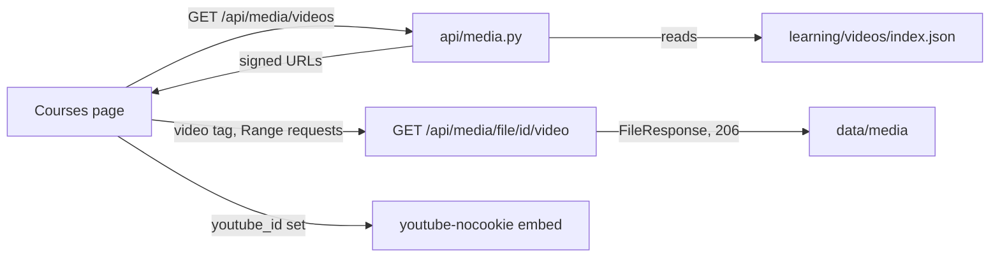

# Course videos in the console

The console plays course videos on the Courses page. The video files stay on
this machine and are not in git. Git holds only a small list of the videos,
the manifest.

How a video is made is in [video-pipeline.md](video-pipeline.md). This page
covers where the files live, how the console serves them, and how to add one.

## Where the files live

| What | Where | In git |
|---|---|---|
| Manifest: one entry per video | `learning/videos/index.json` | yes |
| Video files (`.mp4`) | `data/media/<course>/` | no |
| Captions (`.srt`) | `data/media/<course>/`, next to the video | no |
| YouTube description with the chapter list | `data/media/<course>/<name>.description.txt` | no |

`data/` is in `.gitignore`. The backend reads the media folder from the
`MEDIA_DIR` setting. The default is `data/media` in the repo that runs the
backend.

There are no thumbnails. The owner is the only viewer, and the player shows
the first frame.

## Why the videos are not in git

One video is 160 MB to 1 GB. The 16 inference videos are 6.8 GB together.
GitHub refuses any file over 100 MB.

## How the console plays a video



1. The page asks `GET /api/media/videos` for the list. This call uses the
   normal bearer token.
2. Each entry has signed URLs for its video and its captions. A `<video>` tag
   cannot send an `Authorization` header, so the URL carries a signature for
   that one file. The signature is valid for 24 to 25 hours.
3. The browser loads the video with Range requests. The backend answers
   `206 Partial Content`, so seeking works.
4. The backend converts the SRT captions to WebVTT on each request.
5. If the entry has a `youtube_id`, the player shows the YouTube embed
   instead of the local file.

The signing key comes from `API_BEARER_TOKEN`. A new token makes every old
media URL invalid. With no token set, the files are served without a
signature, the same as every other route in local dev.

## Endpoints

| Method and path | What it does |
|---|---|
| `GET /api/media/videos?course=&phase=&kind=` | The manifest entries, with signed URLs. `phase` matches any of `phase_slugs`. |
| `GET /api/media/file/{id}/video` | The MP4, with Range support. |
| `GET /api/media/file/{id}/captions` | The captions as WebVTT. |
| `PATCH /api/media/videos/{id}` | Body `{"youtube_id": "<URL or id>"}` sets the YouTube id. `null` clears it. |

The file endpoint takes a manifest id, never a path. The id must be in the
manifest, and the file must resolve inside the media folder.

## The manifest entry

```json
{
  "id": "inference-internals-phase-02",
  "kind": "course",
  "course": "inference-internals",
  "phase_slug": "inference-internals-phase-02a-scheduling-memory",
  "phase_slugs": ["inference-internals-phase-02a-scheduling-memory",
                  "inference-internals-phase-02b-decoding-context"],
  "number": null,
  "title": "Inside an LLM Inference Server: ...",
  "duration_s": 1650.9,
  "chapters": [{"t": 0, "title": "Who froze my stream?"}],
  "file": "inference-internals/course-phase-02.mp4",
  "captions": "inference-internals/course-phase-02.srt",
  "youtube_id": null,
  "source_lesson": "learning/lessons/2026-09-20-inference-internals-phase-02a-scheduling-memory.md"
}
```

| Field | Meaning |
|---|---|
| `id` | Lowercase letters, digits and dashes. Unique. |
| `kind` | `course` for a phase video. `youtube` for an episode of the YouTube playlist. |
| `course` | The course key, as `hq.course_phases.course` names it. |
| `phase_slug` | The main phase slug. |
| `phase_slugs` | Every phase the video covers. The Phase 2 video covers 2A and 2B. |
| `number` | The episode number of a `youtube` video. `null` for a course video. |
| `duration_s`, `chapters`, `title` | Filled by `backend/scripts/video_manifest.py`. |
| `file`, `captions` | Paths relative to the media folder. |
| `youtube_id` | Set when the video is uploaded to YouTube as a private video. |
| `source_lesson` | The lesson the video was made from. |

## Add a video by hand

Use this procedure for a video made outside Mission HQ, such as one made with
the `video-remotion` skill. The video pipeline registers its own videos.

1. Set the media folder of the repo that runs the backend:
   `M=/Users/raghvendra.dhakar/Desktop/project/code/missionHq/data/media`
2. Make the course folder: `mkdir -p "$M/inference-internals"`
3. Link the video into it. Use `ln`, not `cp`. A hard link uses no extra
   disk space: `ln -f <render folder>/InfEp13-4K.mp4 "$M/inference-internals/yt-13.mp4"`
4. Link the captions the same way, to `yt-13.srt`.
5. Link the YouTube description the same way, to `yt-13.description.txt`.
   The script reads the chapter list from it.
6. Add an entry to `learning/videos/index.json`. Fill `id`, `kind`, `course`,
   `phase_slug`, `phase_slugs`, `number`, `file`, `captions`, `youtube_id`
   and `source_lesson`. Leave `title` as `""`.
7. Run the script from `backend/`:
   `MEDIA_DIR="$M" uv run python scripts/video_manifest.py`
   Expected result: `wrote .../learning/videos/index.json (N videos)` and no
   `problem:` lines.
8. Run the check: `MEDIA_DIR="$M" uv run python scripts/video_manifest.py --check`
   Expected result: exit code 0.
9. Commit `learning/videos/index.json`.
10. Do not commit the video, captions or description files.

The backend reads the manifest again when the file changes. It needs no
restart for a new entry.

## If a video does not play

| Symptom | Likely cause | Fix |
|---|---|---|
| "The file for this video is not on this machine" | The manifest names a file that is not in the media folder | Link the file, as in steps 3 to 5 |
| The video stops loading after a day in an open tab | The signed URL expired | Press "Reload" under the player |
| An old version of a video plays after a new render | The renderer wrote a new file, and the hard link still points to the old one | Run `ln -f` again for that video |
| `401` on `/api/media/videos` | The console has no token, or the wrong one | Sign in again |
